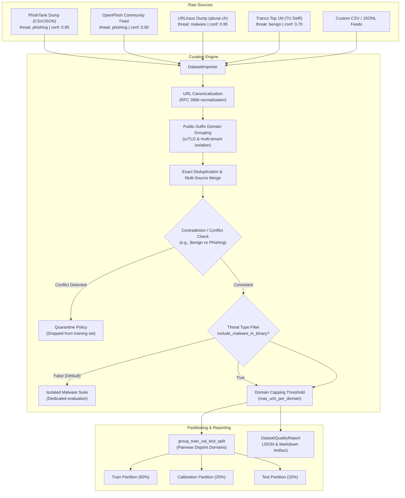

# TrustShield AI — ML Dataset Acquisition & Curation Pipeline (Phase 2A)

This document specifies the safe, reproducible URL dataset acquisition, canonicalization, conflict resolution, and quality audit pipeline for TrustShield AI.

---

## 1. Pipeline Architecture



---

## 2. Supported Threat Intelligence Feeds & File Formats

### 1. PhishTank (Cisco Talos)
- **Format:** CSV or JSON database dump (`verified_online.csv` / `online-valid.json`).
- **Threat Labeling:** `threat_type = "phishing"`, `label = 1`.
- **Confidence Rating:** `0.95` (Verified by community consensus).
- **Licensing & Terms:** PhishTank terms permit free non-commercial and research use with attribution. API keys are required for automated downloads.
- **Limitation:** Subject to human reporter community interest and reporting latency.

### 2. OpenPhish Community Feed
- **Format:** Plain text file containing one active phishing URL per line.
- **Threat Labeling:** `threat_type = "phishing"`, `label = 1`.
- **Confidence Rating:** `0.90` (Algorithmic threat discovery).
- **Licensing & Terms:** OpenPhish community feed is free for non-commercial research use. Commercial production deployment requires an enterprise feed license.
- **Limitation:** Feeds only include active zero-day links; does not include historical ground-truth archive.

### 3. Abuse.ch URLhaus
- **Format:** CSV dump (`https://urlhaus.abuse.ch/downloads/csv/`).
- **Threat Labeling:** `threat_type = "malware"`, `label = 1`.
- **Confidence Rating:** `0.95` (Abuse.ch analyst-verified).
- **Licensing & Terms:** Available under **Creative Commons Zero (CC0 / Public Domain)**.
- **Critical Policy:** **URLhaus malware distribution links are strictly segregated from phishing.** Treating an executable drop site or C2 beacon as a credential-harvesting phishing site degrades tree boundary quality and produces false explanations. By default, `DatasetCurator(include_malware_in_binary=False)` stores URLhaus links in a dedicated malware evaluation suite.

### 4. Tranco Top 1M Research List (TU Delft)
- **Format:** CSV (`rank,domain`).
- **Threat Labeling:** `threat_type = "benign"`, `label = 0`.
- **Confidence Rating:** `0.70` (Cautionary baseline).
- **Licensing & Terms:** Permissive research dataset license by TU Delft.
- **Critical Limitation Warning:** **A high Tranco rank proves only that the apex domain experiences high traffic; it does NOT prove arbitrary URLs under that domain are benign.** Compromised subpaths, open redirects, or cloud-hosted user files (`sites.google.com/view/evil`, `blob.core.windows.net`, `github.io`, `firebaseapp.com`) are frequently abused.

---

## 3. Data Hygiene & Curation Rules

1. **Deterministic URL Canonicalization:**
   - Lowercases scheme and netloc.
   - Strips default protocol ports (`:80` for HTTP, `:443` for HTTPS).
   - Collapses redundant multi-slashes in path (`//` $\rightarrow$ `/`).
   - Strips client-side fragments (`#...`).
   - Deterministically sorts query parameters by key then value.
   - Preserves distinct paths and parameter values; unrelated URLs are never merged.
2. **Public-Suffix-Aware Domain Grouping:**
   - Evaluates multi-part ccTLDs (e.g., `.co.uk`, `.com.au`, `.gov.in`).
   - Evaluates multi-tenant cloud platforms (e.g., `.github.io`, `.pages.dev`, `.firebaseapp.com`, `.netlify.app`, `.vercel.app`).
   - Subdomains of multi-tenant hosts (e.g., `alice.github.io` vs `bob.github.io`) are grouped as **distinct registered domains** rather than merging the entire platform into a single entity.
   - IPv4 host literals are grouped by IP address.
3. **Cross-Source Conflict Quarantine:**
   - If two feeds report conflicting labels for the exact same canonical URL (e.g., Tranco crawler labels `0` while PhishTank labels `1`):
   - The default policy is **`quarantine`**: the contradictory URL is excluded from training sets and documented in the quality report.
4. **Domain Capping Threshold (`max_urls_per_domain`):**
   - Caps the maximum number of URLs retained from any single registered domain (default: 50) to prevent mega-domains from dominating model weights.

---

## 4. Recommended Sample Sizes for Phase 2B Training

To train a robust production Random Forest / HistGradientBoosting model under Render's 512 MB memory constraint:

| Source | Target URL Count | Unique Domain Groups | Threat Category | Role in Training Pipeline |
|:---|:---:|:---:|:---:|:---|
| **Tranco Top 1M (Sampled)** | 45,000 | $\ge 20,000$ | Benign | Primary negative class ($y=0$) |
| **Curated Reference Documentation** | 5,000 | $\ge 1,000$ | Benign | Verified high-signal negative class |
| **PhishTank Verified Dump** | 30,000 | $\ge 10,000$ | Phishing | Primary positive class ($y=1$) |
| **OpenPhish Community Feed** | 15,000 | $\ge 5,000$ | Phishing | Recent positive class ($y=1$) |
| **URLhaus Malware Dump** | 10,000 | $\ge 3,000$ | Malware | Held-out evaluation suite (or multi-class) |
| **Total Target** | **~105,000 URLs** | **$\ge 35,000$ domains** | Balanced | ~3–5 MB model size ($< 2\text{ ms}$ inference) |

---

## 5. Programmatic Python Execution

```python
from backend.app.ml.dataset_importer import DatasetImporter
from backend.app.ml.curator import DatasetCurator

# 1. Ingest raw feeds (offline files)
phishtank_recs = DatasetImporter.import_phishtank("data/verified_online.csv")
openphish_recs = DatasetImporter.import_openphish("data/openphish_feed.txt")
urlhaus_recs   = DatasetImporter.import_urlhaus("data/urlhaus_dump.csv")
tranco_recs    = DatasetImporter.import_tranco("data/tranco_top1m.csv", max_records=50000)

raw_records = phishtank_recs + openphish_recs + urlhaus_recs + tranco_recs

# 2. Curate, deduplicate, resolve conflicts, and segregate malware
curator = DatasetCurator(
    conflict_policy="quarantine",
    include_malware_in_binary=False,  # Separates URLhaus malware from phishing model
    max_urls_per_domain=50,
)
curated_records, quality_report = curator.curate(raw_records)

# 3. Partition with mathematical guarantee of zero domain overlap
train_recs, cal_recs, test_recs = curator.partition_dataset(
    curated_records,
    val_ratio=0.20,
    test_ratio=0.20,
    random_seed=42,
    report=quality_report,
)

# 4. Export quality report & partitioned data
print(quality_report.to_markdown())
with open("data/quality_report.json", "w", encoding="utf-8") as f:
    f.write(quality_report.to_json())

curator.export_dataset_csv(train_recs, "data/train_partition.csv")
curator.export_dataset_csv(cal_recs, "data/cal_partition.csv")
curator.export_dataset_csv(test_recs, "data/test_partition.csv")
```

---

## 6. Safety & Verification Guardrails

- **Zero Crawling:** The pipeline performs purely offline lexical and syntactic parsing. No HTTP requests are sent to target URLs.
- **Zero Credential Collection:** Ingestion processes URL strings exclusively; no credentials, sessions, or private user URLs are logged or stored.
- **Zero Third-Party Data Transmission:** Ingested datasets remain strictly on the local developer or container filesystem.

